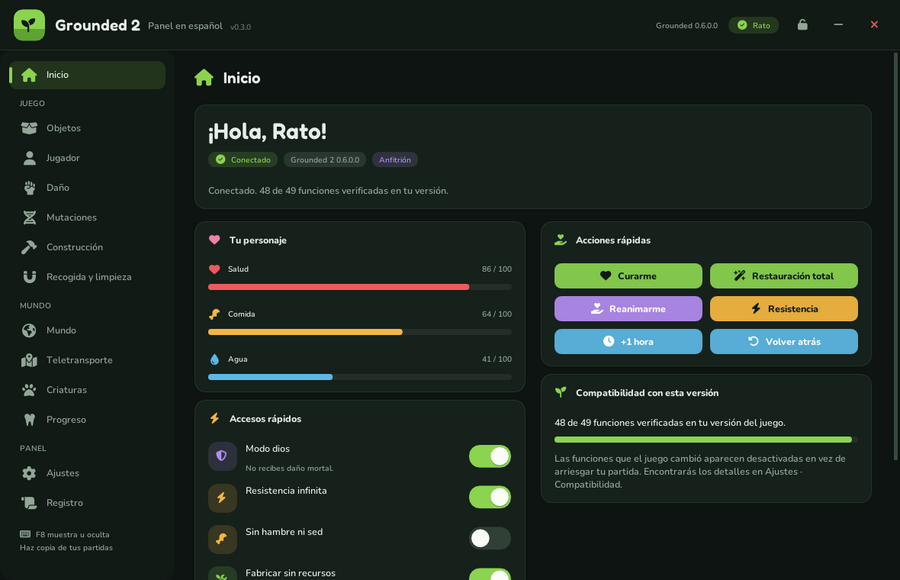
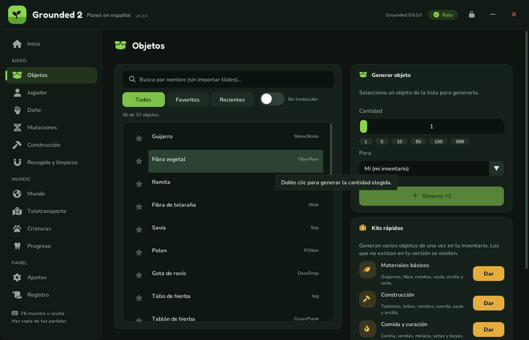
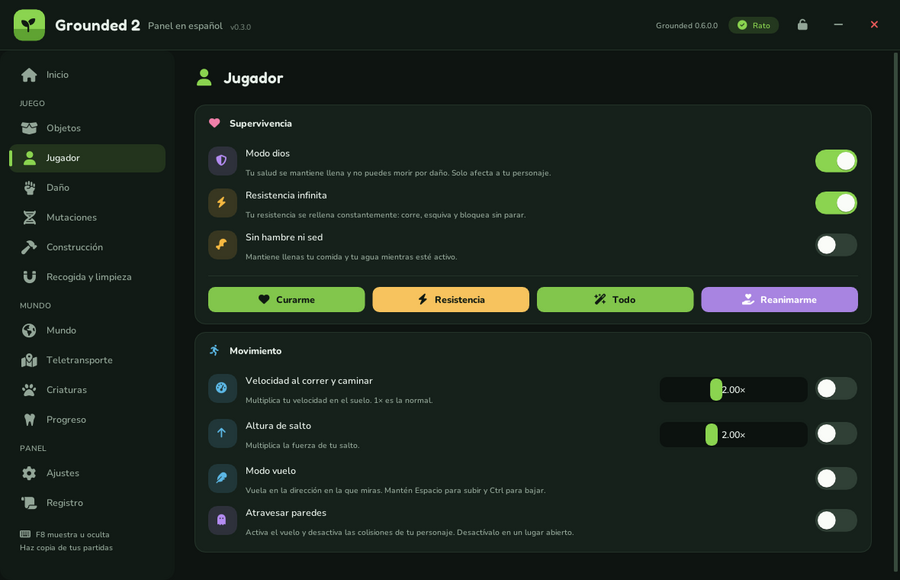
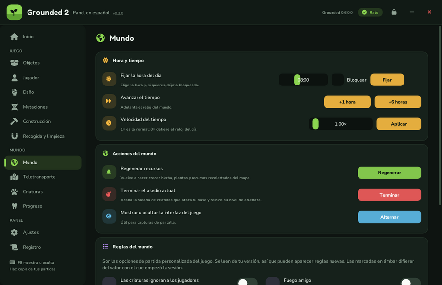
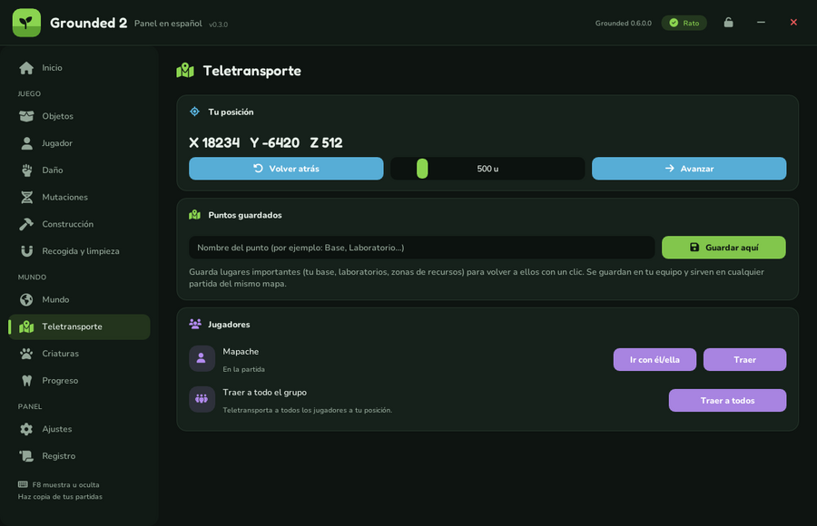
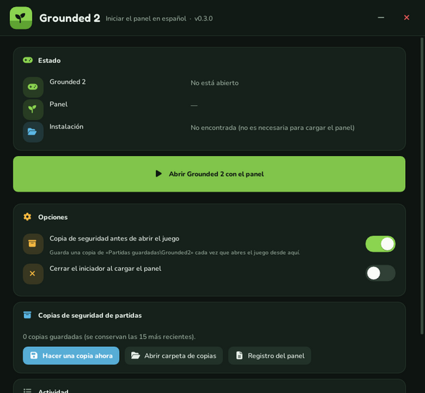

# Grounded 2 · Panel en español 0.3.1

Panel de trucos y utilidades **en español** para **Grounded 2 (Steam)**, actualizado para la versión **0.6.0 «Rot and Ruin»**, con interfaz nueva, iniciador propio y paquete listo para **Vortex**.
Derivado de [Grounded2Minimal](https://github.com/x0reaxeax/Grounded2Minimal) (x0reaxeax) y de Grounded2PanelES 0.2.0. Licencia GPL-3.0-or-later.



| Objetos | Jugador |
| --- | --- |
|  |  |
| **Mundo** | **Teletransporte** |
|  |  |



> Las capturas son de `VistaPrevia.exe` (la interfaz real con datos de ejemplo).

## Descarga

El paquete para Vortex está en [`releases/Grounded2PanelES-Steam-0.3.1.zip`](releases/Grounded2PanelES-Steam-0.3.1.zip). Instrucciones completas de instalación y uso en [`LEEME.txt`](LEEME.txt).

Resumen:
1. En Vortex, desactiva y elimina la 0.2.0 si la tenías.
2. Arrastra el zip a **Mods**, instala y activa. Se despliega en `<juego>\Augusta\Binaries\Win64\Grounded2PanelES\`.
3. Añade `IniciarPanel.exe` como herramienta de Vortex con el argumento `--auto`.
4. Pulsa la herramienta: hace copia de tus partidas, abre el juego por Steam y carga el panel. **F8** lo muestra u oculta.

## ¿Por qué esta versión aguanta las actualizaciones del juego?

La 0.2.0 dependía de direcciones de memoria y de un control de versión exactos de Grounded 2 0.5.1.1, así que dejó de funcionar con la 0.6.0. La 0.3.x:

- **Localiza sola las estructuras de Unreal** al arrancar (`src/panel/core/Resolver.cpp`): busca la tabla de objetos en las secciones del ejecutable y la valida objeto a objeto, encuentra la tabla de nombres por sus primeras entradas («None», «ByteProperty») y la decodifica con código propio, y verifica el índice de `ProcessEvent`.
- **Usa las clases del juego por nombre** (`src/panel/core/Reflect.cpp`): cada miembro y cada función se buscan en el juego en ejecución, comprobando nombres, tipos y tamaños de parámetros antes de llamarlos.
- **Desactiva en vez de romper** (`src/panel/game/Features.cpp`): cada función del panel declara lo que necesita; si una actualización lo cambió, aparece en gris con el motivo. Si cambió el motor Unreal, el panel se pone en pausa.

## Estado de las pruebas

| Comprobación | Resultado |
| --- | --- |
| Compilación con MinGW-w64 y todas las aserciones de estructura del SDK | correcta |
| Pruebas de lógica (`tests/logic_tests.cpp`: validaciones, búsqueda, decodificador de nombres, ajustes) | superadas |
| Motor simulado (`tests/FakeEngine.cpp`: estructuras de Unreal en direcciones desconocidas) bajo Wine | encuentra objetos, nombres, `ProcessEvent` y versión; sin clases reales se pone en pausa sin tocar nada |
| Interfaz del panel y del iniciador en ejecución (Wine + Direct3D 11) | correcta (capturas de arriba) |
| **Dentro de Grounded 2 0.6.0** | **no probado**: no hay copia del juego en el entorno de compilación |

Si algo no funciona en tu partida, el panel lo indica en **Ajustes · Compatibilidad** y en el **Registro** (`%LOCALAPPDATA%\Grounded2PanelES\registro.txt`).

## Compilar

Linux, WSL o MSYS2 con MinGW-w64:

```sh
sudo apt-get install g++-mingw-w64-x86-64-posix cmake python3 unzip zip curl
./build.sh            # descarga y adapta el SDK, compila, pasa las pruebas y crea dist/Grounded2PanelES-Steam-0.3.1.zip
```

- El SDK de Dumper-7 lo descarga de la publicación `sdk` de Grounded2Minimal (no se incluye aquí). `scripts/patch_sdk.py` lo adapta a GCC: offsets globales modificables en ejecución, relleno final de clases para reproducir el diseño de MSVC (verificado por las propias aserciones del SDK) y arreglos menores.
- Si Grounded2Minimal publica un SDK nuevo para 0.6.0, basta con volver a ejecutar `build.sh` tras borrar `build/`.
- La integración continua (`.github/workflows/compilar.yml`) ejecuta lo mismo en cada cambio.

## Estructura

```
src/common/        Tema visual, ventana Direct3D 11 sin bordes, rutas
src/panel/core/    Registro, memoria, localización del motor, reflexión
src/panel/game/    Puente interfaz-juego, sesión, acciones, catálogo, ganchos, ajustes
src/panel/ui/      Ventana y páginas del panel
src/launcher/      IniciarPanel.exe (Steam, carga, copias de seguridad)
tools/Preview.cpp  VistaPrevia.exe
tests/             Pruebas de lógica y motor simulado
third_party/imgui  Dear ImGui 1.91.9 (MIT)
assets/            Icono y fuentes (subconjuntos OFL)
```

## Créditos

- [Grounded2Minimal](https://github.com/x0reaxeax/Grounded2Minimal) — x0reaxeax (GPL-3.0): base del mod, ganchos y comandos del juego.
- [Dumper-7](https://github.com/Encryqed/Dumper-7) — SDK.
- [Dear ImGui](https://github.com/ocornut/imgui) — interfaz (MIT).
- Nunito, Fredoka (SIL OFL 1.1) y Font Awesome Free (SIL OFL 1.1 / CC BY 4.0).

Grounded 2 pertenece a Obsidian Entertainment / Xbox Game Studios. Este mod no está afiliado a ellos. Haz copia de tus partidas.
